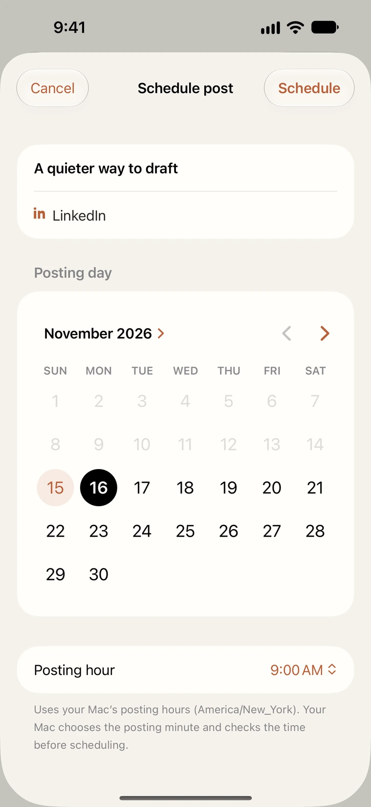

<p align="center"></p>

<h1 align="center">Inkspring</h1>

<p align="center"><strong>Your private writing studio.</strong><br>Research an idea, write a draft, and decide when it goes out.</p>

<p align="center"><a href="https://inkspring.ai/download"><strong>Download for Mac</strong></a> · <a href="#build-it-yourself">Build it yourself</a> · <a href="https://inkspring.ai">Visit Inkspring</a></p>

## A writing workspace for Mac

Collect references and post ideas, then turn an idea into an editable social draft or a newsletter. Write by hand, use a connected agent, or bring an API key. Review the text, attachments, and destination before you schedule or publish.


## Review and schedule on iPhone and iPad

Review and edit recent drafts, save ideas, and choose a posting day and hour. With iCloud sync configured, your Mac receives the scheduling request and applies your preferred posting hours and minute settings.

<table>
<tr><th>iPhone · Choose a posting time</th><th>iPad · Review a draft</th></tr>
<tr>
<td align="center" valign="top"></td>
<td align="center" valign="top"></td>
</tr>
</table>

*Native app screenshots show sample content.*

## What's inside

- **Research and ideas.** Save sources, explore angles by project, and turn an idea into a draft for the platforms you choose. The original idea stays in your workspace.
- **Writing and newsletters.** Edit a post, attach an image or video, and draft newsletters with Markdown and previews.
- **Scheduling.** Set preferred hours by platform on Mac and review what's ready, scheduled, and already published.
- **AI and integrations.** Connect Claude or Codex on Mac, or configure a supported provider. Inkspring uses the connections you enable for AI, research, and publishing.
- **Storage and backups.** The Mac workspace is stored locally. Export a ZIP with drafts and media, restore it, or set up scheduled backups. The companion uses your private iCloud account for sync.

[Social setup](SOCIAL_SETUP.md) · [Agent setup](docs/agent-app-setup.md) · [Newsletter setup](docs/substack-newsletters.md) · [Backups](docs/backups.md)

## Build it yourself

Use a Mac with Xcode installed. The Mac app supports macOS 14 and later.

```sh
git clone https://github.com/protomota/inkspring.git
cd inkspring
native-mac/build-app.sh "$PWD/.build/local"
open "$PWD/.build/local/Inkspring.app"
```

For iPhone and iPad, open [InkspringCompanion.xcodeproj](native-mac/InkspringCompanion.xcodeproj) and run the **InkspringCompanion** scheme on a simulator. A physical device requires your own signing team and bundle identifier. Cross-device iCloud sync in your own build also requires your own CloudKit container and matching entitlements.

[Native build and usage guide](native-mac/README.md) · [Validation guide](VALIDATION.md)

## Free to use. Source available.

Inkspring's original code and artwork are © 2026 Protomota, LLC under the [Inkspring Source-Available License 1.0](LICENSE). You may inspect, build, modify, and redistribute the software noncommercially. Commercial distribution requires written permission from Protomota. Personal and paid work are permitted, and your writing remains yours. Third-party components retain their own licenses.

[Website](https://inkspring.ai) · [Send feedback](https://protomota.com/apps?app=inkspring#feedback) · [Licensing](mailto:legal@protomota.com)
